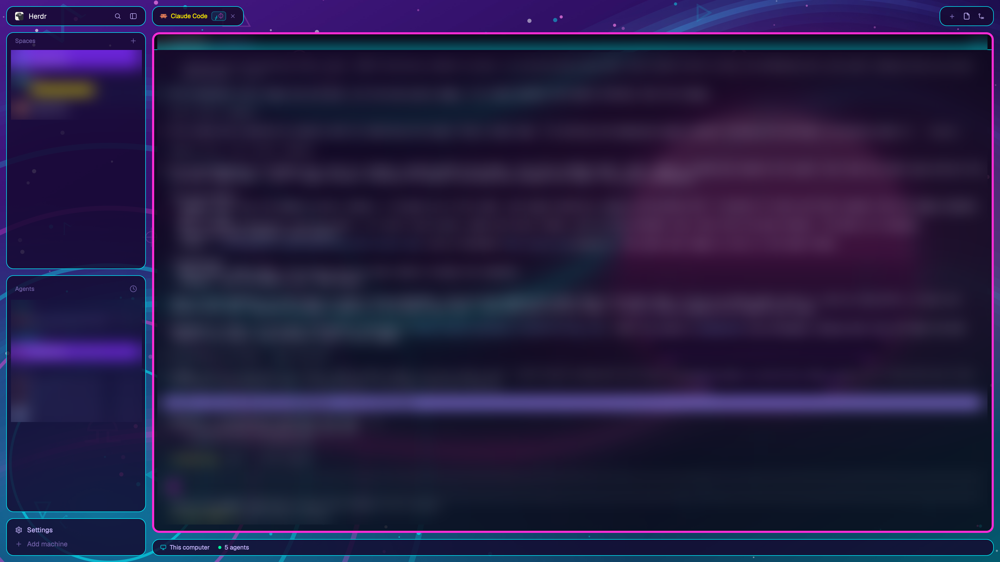

# herdr-neon-city

A neon synthwave look for the [Herdr](https://herdr.dev) desktop app: a purple-to-teal
aurora background, cyan-bordered rounded "islands", and a magenta focus ring.



## Install

```sh
git clone https://github.com/m-interwebb/herdr-neon-city.git
cd herdr-neon-city
./install.sh
```

Open Herdr at least once first (it creates `~/.config/herdr-app`). The first run
copies everything into place and switches Herdr to the `neon-islands` layout.
Later runs (after `git pull`) update the files and leave your current layout alone.

## What you get

| Herdr layout | Look |
|---|---|
| `neon-islands` | Floating islands over the aurora background; the `neon-city` theme in light mode, `atom-one-dark` in dark |
| `cyberpunk` | Stock-style layout in the `neon-city` theme, 78% terminal opacity |

`Cmd/Ctrl-Shift-L` cycles Herdr's layouts.

## What's in here

| Path | What it is |
|---|---|
| `neon-city/` | The Herdr layout, laid out like Herdr's home (`~/.config/herdr-app`). `RECIPE.md` describes it in full. |
| `neon-city/layouts/` | `neon-islands.json`, `cyberpunk.json` and the `neon-islands` preview |
| `neon-city/themes/` | `neon-city.json` |
| `neon-city/mods/` | `neon-agents`, `neon-pane`, `neon-tabs`, `islands-spaces`, `islands-workspace-chrome`, `islands-workspace-status` |
| `neon-city/backgrounds/` | The aurora and grid images (`.jpg` plus editable `.svg`) |

## Changing it

Edit live in `~/.config/herdr-app` (Herdr hot-reloads), then run `./capture.sh` to copy
the changes back here and commit. Check a mod with
`herdr-app check ~/.config/herdr-app/mods/<mod>`.
