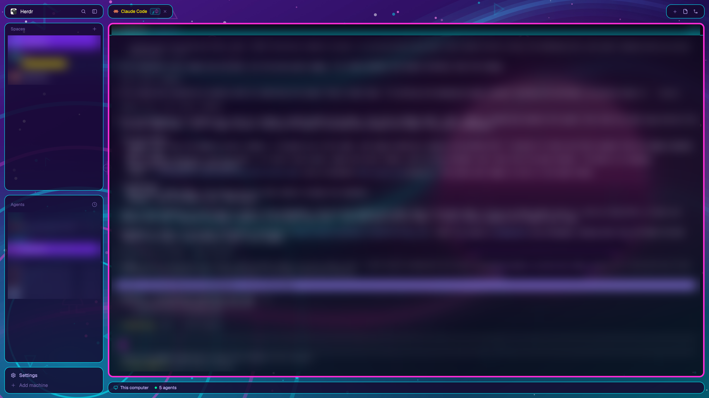

# Neon Islands

A dark synthwave window for herdr. Every region is a rounded "island" with a 1px cyan border floating over a purple-to-teal aurora image, with a magenta ring on the focused pane. Panes are semi-transparent so the background shows through.

## What you see
- **Left column (268px, not resizable):** brand bar (38px, "Herdr", search and sidebar toggle), a Spaces island, an Agents island, then Settings / Add machine.
- **Top bar:** neon tab strip (`Tabs (neon)`) with the window buttons on the right. No native titlebar; traffic lights at (12,16).
- **Main area:** the terminal pane with a neon pane header (title and cwd, split/zoom/close icons). Optional Files and Changes side panels.
- **Bottom bar:** workspace status ("This computer", agent count).
- **Colors:** theme `neon-city` (bg `#0a0613`, fg `#e8e4ff`, cyan `#00f5ff` borders, magenta `#ff2bd6` accent, selected `#6a24d6`). Dark appearance falls back to `atom-one-dark`.
- **Type:** Geist Mono 14 for terminals, Geist for UI. Gap and padding 12, radius 14, terminal padding [16,14].
- **Art:** `backgrounds/neon-aurora.jpg`, fit `cover` (editable source `neon-aurora.svg`).

## How it behaves
- Agent statuses use the theme colors: working `#00f5ff`, blocked `#ff2d6f`, done `#00ff9c`, idle `#b794ff`. The Agents list groups by Done / Working / Blocked / Idle.
- Clicking a space or agent focuses it. Spaces show the git branch.
- The focused pane gets the accent border. The sidebar toggle collapses the left column.

## Built from
- `layouts/neon-islands.json`: root row with a sidebar column and a main column; `background`, `theme` `{light:"neon-city", dark:"atom-one-dark"}`, `terminal_opacity` 0, `titlebar` "none".
- Mods in this repo: `neon-agents`, `neon-pane`, `neon-tabs` (all `place: none`, used by the layout); `islands-spaces`, `islands-workspace-chrome`, `islands-workspace-status`.
- Shipped mods used: `files`, `changes`.
- `themes/neon-city.json`: 16 ANSI colors plus panel colors (`canvas`, `chrome`, `surface`, `popover`, `raised`, `hover`, `selected`, `border`, `input`, `muted`, `dim`, `accent`, `solid`, status colors).
- `layouts/cyberpunk.json`: an alternate layout using `neon-city` with `terminal_opacity` 0.78 and stock mods.
- `theme: neon-city` is set per layout; no settings.json is shipped.

## Watch out
- `islands-spaces` runs `git` (`status`, `rev-parse`) in each space's cwd. No network access.
- `islands-workspace-chrome` can rewrite the layout file from a stale copy when its `settings.json` is saved, which silently reverts layout edits such as the background. Re-check the layout's `background` after editing its settings.
- The `gpui-kit.d.ts` type files are not included; herdr regenerates them.
- `preview.png` has the sidebar names and terminal contents blurred.

## Done when
- `herdr-app check` passes for each mod folder.
- `layout.switch neon-islands` shows the aurora background, cyan-bordered islands and a magenta focused-pane ring.
- Picking `neon-city` in Settings recolors the panes and chrome.
